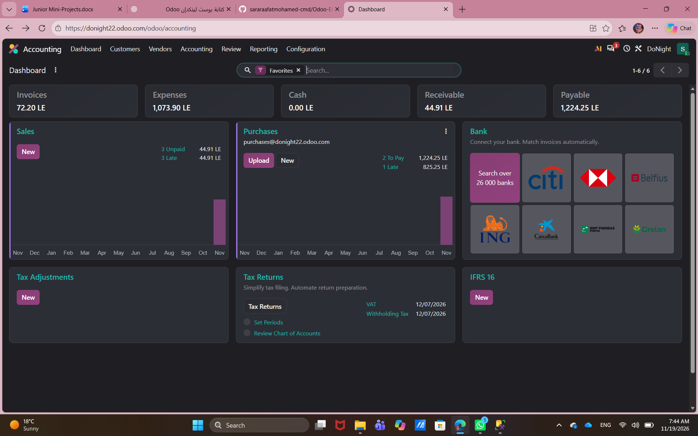
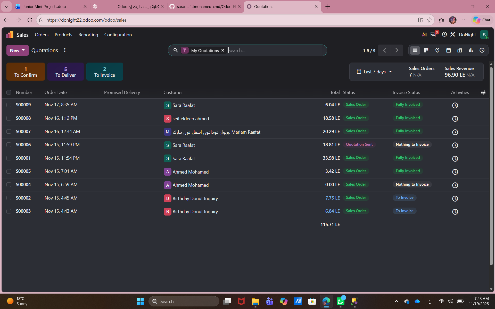
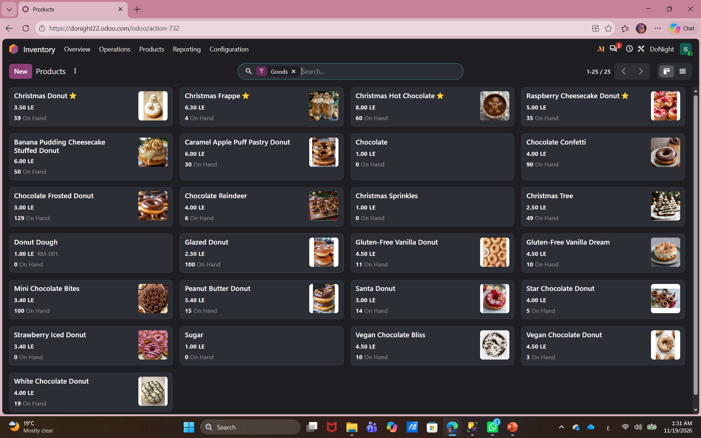
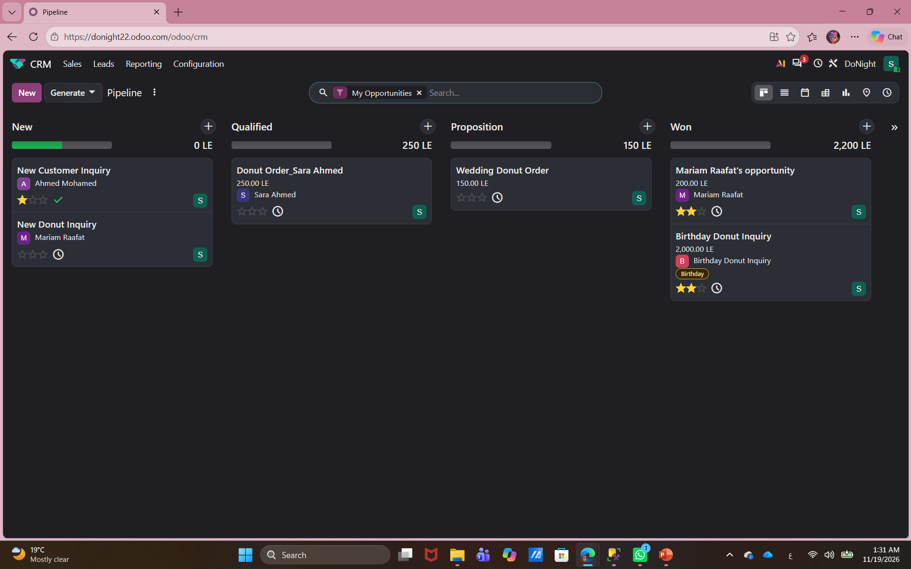
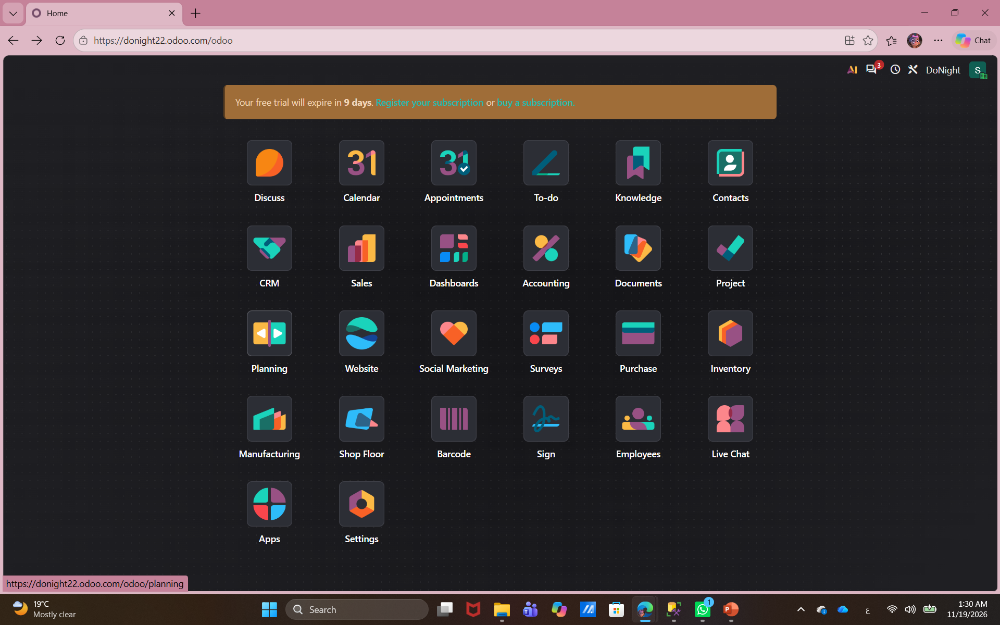
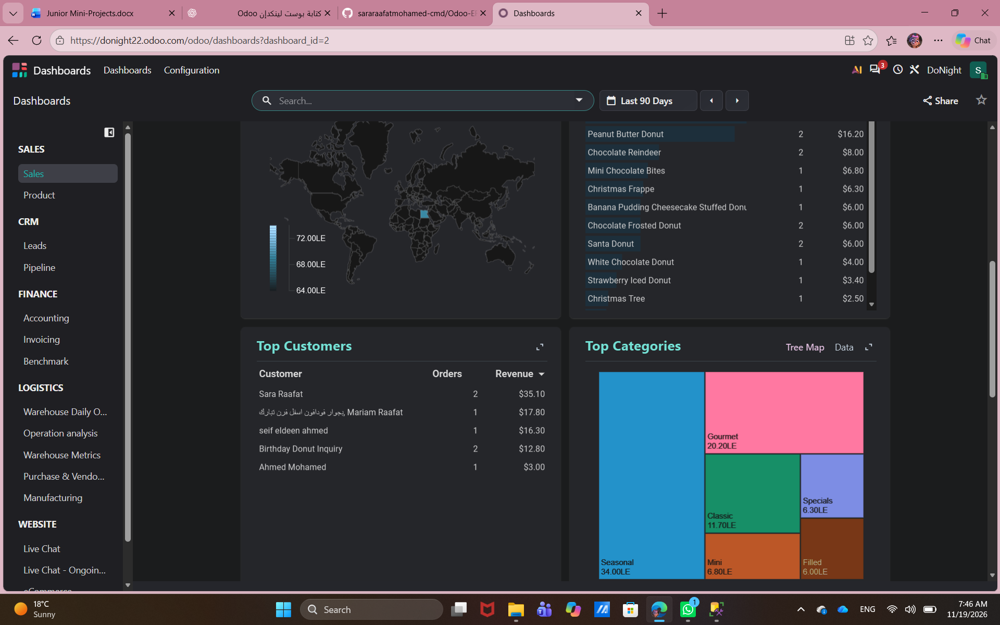

# 🍩 Odoo ERP – Practical Project
### My First Step into the World of Odoo

## 📌 Project Overview

This project represents my first hands-on experience with **Odoo ERP**, completed as a practical academic assignment for the **Organizations Information Systems** course at Modern Academy.

The project focused on exploring and working with different Odoo modules to understand how an integrated Enterprise Resource Planning (ERP) system connects various business functions and supports organizational operations.

Through this experience, I explored different business workflows and applied my knowledge in a practical business scenario by creating **DoNight**, a donut shop website using Odoo.

## 🎯 Project Objectives

- Gain hands-on experience with Odoo ERP.
- Explore different ERP modules and their functionalities.
- Understand how business processes are connected across departments.
- Learn how information flows within an integrated ERP system.
- Apply theoretical concepts from the course to a practical business scenario.

## 🛠️ Odoo Modules Explored

During this project, I worked with the following modules:

| Module | Description |
|---|---|
| CRM | Managing customer relationships and sales opportunities. |
| Sales | Handling sales operations and customer orders. |
| Purchase | Exploring purchasing processes and vendor operations. |
| Inventory | Managing products, stock, and warehouse operations. |
| Accounting | Exploring financial operations and accounting records. |
| Website | Creating and customizing a business website. |
| Manufacturing | Exploring manufacturing processes and work orders. |
| Employees | Managing employee information and records. |

## 🍩 Practical Implementation – DoNight

As part of this project, I created **DoNight**, a donut shop website using Odoo.

This implementation provided an opportunity to explore website creation and apply Odoo's business capabilities in a practical business scenario.

🔗 **Live Website:** [Visit DoNight](https://donight22.odoo.com/)

## 📸 Project Screenshots

The following screenshots document my practical work and exploration of the different Odoo modules.

## 📸 Project Screenshots

### Accounting

### Purchase

### DoNight Website

### Sales

### DoNight Website – Additional View

### Employees

### Inventory

### CRM

### Dashboard

### Dashboards

## 📚 Key Learnings

Through this practical experience, I gained a better understanding of:

- The role of ERP systems in managing organizational operations.
- How different business departments interact through an integrated system.
- The relationship between CRM, sales, purchasing, inventory, and accounting.
- How Odoo supports business processes through different modules.
- The practical application of ERP concepts in a business environment.

## 🎓 Academic Context

- **Course:** Organizations Information Systems
- **Institution:** Modern Academy
- **Project Type:** Practical Academic Assignment
- **Platform:** Odoo ERP

## 🚀 Future Learning

This project marks the beginning of my journey with Odoo ERP. I look forward to exploring more ERP functionalities and gaining further practical experience with business systems.

---

**A step forward in connecting business knowledge with practical technology.** 🤎

